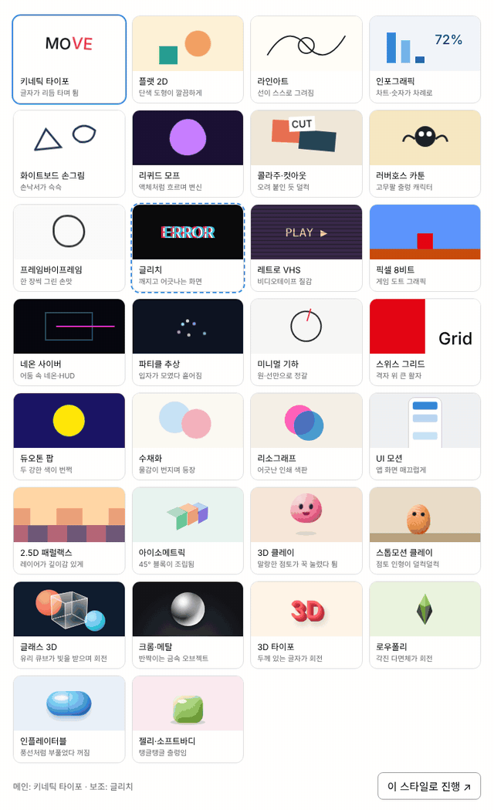
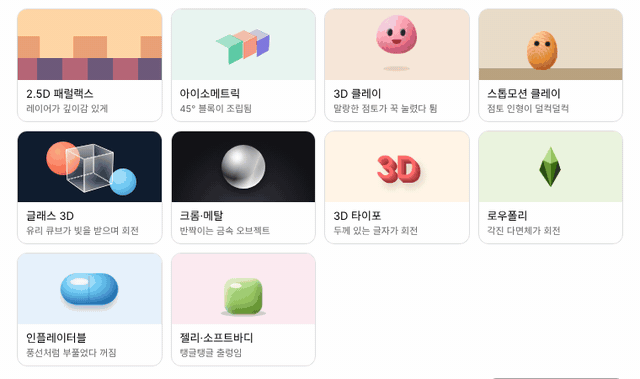
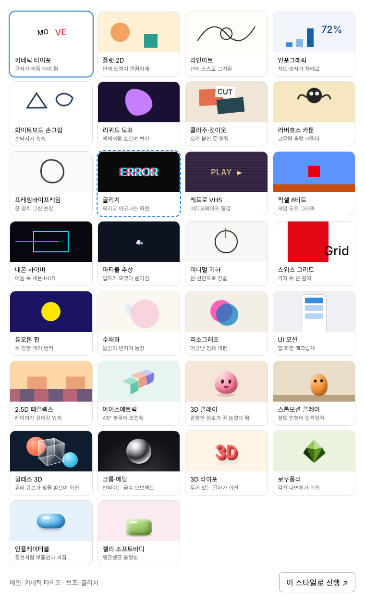

# Motion Style Picker 🎬

[](https://skills.sh/eminoart/motion-style-picker)

**Pick a motion graphics style by sight, not by name.**
An Agent Skill for Claude, Claude Code, Codex / ChatGPT, Cursor, Gemini CLI and other agents that read `SKILL.md`.

**스타일 이름을 몰라도, 움직이는 예시를 보고 고르는 모션그래픽 스타일 선택 스킬.**
*"모션그래픽 스타일 이름을 모르겠어"* — 그럴 때 쓰는 스킬이에요.

<p align="center">
  
</p>
<p align="center"><sub>The in-chat gallery: click once for the main style (solid outline), again for an accent (dashed).<br>채팅 안에 뜨는 갤러리. 첫 클릭은 메인 스타일(실선), 두 번째 클릭은 보조 스타일(점선)이에요.</sub></p>

<p align="center">
  
</p>
<p align="center"><sub>3D styles · 3D 스타일</sub></p>

[English](#english) · [한국어](#한국어) · [Sample output / 결과 예시](#sample-output--결과-예시)

---

## English

### What it does

Most people can't name the motion style they want, so they say "make it look cool" or "make it move." This skill:

1. Asks 3 multiple-choice questions: purpose (logo intro, explainer, short-form ad, UI motion), aspect ratio, and output.
2. Shows an **animated, grouped preview gallery that uses your own words** — 69 styles in five groups (2D basics, illustrated, 3D, retro & texture, graphic & explainer), plus 9 short-form formats (quiz, tier list, chat story…), 7 caption overlays and 5 motion feels (smooth, on twos, on threes, pose to pose, stroke by stroke). Type your brand name or copy and every preview animates it. Click a style card for **Main ✓**, another for an optional **Accent ✓**; formats, overlays and feel show **Picked ✓** and are optional.
3. Asks about animation types (line draw, mask reveal, kinetic text, beat-synced cuts…) and tempo (smooth, springy, snappy, dreamy), then length, elements, colour and ending.
4. Works in **English or Korean**: questions follow your language, and the gallery has an English / 한국어 switch.
5. Writes a **scene-by-scene breakdown** and a ready-to-paste **English motion prompt** with palette hex codes, fps, easing, transitions and things to avoid. It can go on to build an HTML animation, an MP4 or an After Effects brief.

**Styles:** kinetic typography, flat 2D, line art, infographic, whiteboard doodle, liquid morph, paper collage, rubber hose, frame-by-frame, glitch, retro VHS, pixel 8-bit, neon cyber, particle abstract, geometric minimal, Swiss grid, duotone pop, watercolor, risograph, UI motion, 2.5D parallax.
**3D:** isometric, 3D clay, claymation (stop-motion clay), glass 3D, chrome/metal, 3D typography, low-poly, inflatable, jelly/soft-body.

**Try the gallery now:** https://eminoart.github.io/motion-style-picker/ (or open [`assets/gallery.html`](skills/motion-style-picker/assets/gallery.html) locally).

### Install

**Easiest: ask your AI.** Paste this into Claude Code, Codex, Cursor, Claude or ChatGPT:

> Install this skill: https://github.com/eminoart/motion-style-picker

The agent reads [`AGENTS.md`](AGENTS.md) and installs the skill in the right place for that tool.

**One command (any agent with a terminal):**

```sh
npx skills add eminoart/motion-style-picker -g -y
```

**Or use the installer script.** It copies the skill into every agent folder it finds (`~/.claude`, `~/.agents`, `~/.codex`, `~/.cursor`, `~/.gemini`):

```sh
curl -fsSL https://raw.githubusercontent.com/eminoart/motion-style-picker/main/install.sh | sh
```

**Claude.ai, Claude desktop and ChatGPT (no terminal):** download [`dist/motion-style-picker.zip`](dist/motion-style-picker.zip) and upload it on the app's Skills settings page.

| Tool | Where the skill goes |
|---|---|
| Claude Code | `~/.claude/skills/motion-style-picker/` |
| Codex / ChatGPT desktop | `~/.agents/skills/motion-style-picker/` |
| Cursor | `~/.cursor/skills/motion-style-picker/` |
| Gemini CLI | `~/.gemini/skills/motion-style-picker/` |
| Claude.ai / ChatGPT web | Upload the zip in Skills settings |

### Use

Say something like *"help me pick a motion graphics style for a logo intro"* or *"make my product video look cool."* You can also invoke it by name: `/motion-style-picker` (Claude Code, Cursor) or `$motion-style-picker` (Codex).

---

## 한국어

### 무엇을 하나요

모션그래픽 스타일 이름을 몰라서 "영상 멋지게", "움직이게"라고만 말하게 되는 경우가 많아요. 이 스킬은 이렇게 진행돼요.

1. 객관식 3문항으로 용도(로고 인트로, 설명 영상, SNS 숏폼, UI 모션), 화면 비율, 결과물을 묻습니다.
2. **그룹별로 실제로 움직이는 미리보기 갤러리**를 보여 줍니다. 스타일 69종(2D 기본, 일러스트·손그림, 3D, 레트로·텍스처, 그래픽·설명형)에 숏폼 포맷 9종(퀴즈, 티어 리스트, 채팅 스토리…), 편집 오버레이 7종, 움직임 느낌 5종(부드럽게, 투스, 쓰리스, 포즈 투 포즈, 한 획씩)이 있어요. 위 칸에 브랜드 이름이나 카피를 쓰면 모든 미리보기가 그 글자로 움직여요. 스타일 카드를 누르면 **메인 ✓**, 하나 더 누르면 **보조 ✓**, 포맷·오버레이·느낌은 **선택 ✓**(선택 사항)이 붙어요.
3. 애니메이션 유형(라인 드로잉, 마스크 리빌, 키네틱 텍스트, 비트 싱크 컷 등)과 템포(차분, 탄력, 딱딱 끊김, 몽환)를 묻고, 이어서 길이, 요소, 색, 마무리를 묻습니다.
4. **한국어와 영어**를 모두 지원해요. 질문은 쓰는 언어로 나오고, 갤러리 오른쪽 위에서 한국어/English를 바꿀 수 있어요.
5. **장면 구성표**와 바로 붙여 넣을 수 있는 **영어 모션 프롬프트**를 만들어 줍니다. 팔레트 hex, fps, 이징, 전환 방식, 피할 것까지 담겨요. 원하면 HTML 애니메이션, MP4, After Effects 작업 지시서까지 이어서 만들어요.

**스타일:** 키네틱 타이포, 플랫 2D, 라인아트, 인포그래픽, 화이트보드 손그림, 리퀴드 모프, 콜라주·컷아웃, 러버호스 카툰, 프레임바이프레임, 글리치, 레트로 VHS, 픽셀 8비트, 네온 사이버, 파티클 추상, 미니멀 기하, 스위스 그리드, 듀오톤 팝, 수채화, 리소그래프, UI 모션, 2.5D 패럴랙스.
**3D:** 아이소메트릭, 3D 클레이, 스톱모션 클레이, 글래스 3D, 크롬·메탈, 3D 타이포, 로우폴리, 인플레이터블, 젤리·소프트바디.

**갤러리 바로 보기:** https://eminoart.github.io/motion-style-picker/ (또는 [`assets/gallery.html`](skills/motion-style-picker/assets/gallery.html)을 브라우저로 열기)

### 설치

**가장 쉬운 방법: AI에게 말하기.** Claude Code, Codex, Cursor, Claude, ChatGPT에 이렇게 붙여 넣으세요.

> 이 스킬 설치해줘: https://github.com/eminoart/motion-style-picker

AI가 [`AGENTS.md`](AGENTS.md)를 읽고, 쓰고 있는 도구에 맞는 위치에 설치해요.

**명령어 한 줄 (터미널이 있는 도구):**

```sh
npx skills add eminoart/motion-style-picker -g -y
```

**설치 스크립트를 써도 돼요.** 찾은 에이전트 폴더(`~/.claude`, `~/.agents`, `~/.codex`, `~/.cursor`, `~/.gemini`)에 모두 복사해요.

```sh
curl -fsSL https://raw.githubusercontent.com/eminoart/motion-style-picker/main/install.sh | sh
```

**Claude.ai, Claude 데스크톱, ChatGPT (터미널 없음):** [`dist/motion-style-picker.zip`](dist/motion-style-picker.zip)을 내려받아 앱의 스킬 설정 화면에서 업로드하세요.

| 도구 | 설치 위치 |
|---|---|
| Claude Code | `~/.claude/skills/motion-style-picker/` |
| Codex / ChatGPT 데스크톱 | `~/.agents/skills/motion-style-picker/` |
| Cursor | `~/.cursor/skills/motion-style-picker/` |
| Gemini CLI | `~/.gemini/skills/motion-style-picker/` |
| Claude.ai / ChatGPT 웹 | 스킬 설정에서 zip 업로드 |

### 사용

*"모션 스타일 골라줘"*, *"로고 인트로 영상 멋지게 만들고 싶어"*처럼 말하면 돼요. 이름으로 직접 부를 수도 있어요. Claude Code와 Cursor에서는 `/motion-style-picker`, Codex에서는 `$motion-style-picker`로 불러요.

---

## Sample output / 결과 예시

Choices: SNS short-form · 9:16 · main **kinetic-type** + accent **glitch** · kinetic text, beat-synced cuts · snappy · 10–15 s
선택: SNS 숏폼 · 9:16 · 메인 키네틱 타이포 + 보조 글리치 · 키네틱 텍스트, 비트 싱크 컷 · 빠르고 딱딱 끊김 · 10~15초

```
장면 구성
1. 0–2s  검은 화면, "STOP" 글자가 박자마다 커졌다 줄어듦
2. 2–6s  핵심 카피 3단어가 비트에 맞춰 한 단어씩 튀어나오고, 컷마다 RGB 글리치
3. 6–10s 제품 이름이 화면을 꽉 채우며 회전, 마지막 박자에 글리치로 깨짐
4. 10–12s 로고 + CTA, 글리치 잔상이 걷히며 정지

English motion prompt
Vertical 9:16, 12 seconds at 30 fps, kinetic typography with glitch accents.
Palette: #0A0A0A background, #FFFFFF type, #FF004C and #00F0FF for RGB-split frames.
Bold condensed sans words scale and rotate on every beat with snappy easing
(cubic-bezier(0.7,0,0.3,1)), hard cuts between phrases, a 2-frame RGB split
and scanline jitter on each cut. End on the logo and a CTA as the glitch settles
into a clean still frame. Avoid gradients, soft fades, drop shadows and more
than three words on screen at once.
```

<p align="center">
  
</p>

## Find it / 검색

`npx skills find` or the find-skills skill should match searches like:
`npx skills find`나 find-skills로 이렇게 찾을 수 있어요.

- 모션그래픽 스타일 이름을 모르겠어 · 모션그래픽 스타일이름을 모르겠어 · 모션 그래픽 스타일 추천 · 애니메이션 스타일 고르기 · 3D 클레이 애니메이션
- I don't know the name of the motion graphics style · motion graphics style picker · animation style · motion design style

## Repository layout

```
skills/motion-style-picker/
├── SKILL.md                    # workflow and style data (gallery opens by link)
└── assets/
    ├── gallery.html            # standalone gallery (also served at GitHub Pages)
    └── gallery-widget.html     # fragment for the in-chat widget
docs/gallery.gif, gallery-3d.gif, gallery.png  # preview images
dist/motion-style-picker.zip   # upload package for Claude.ai / ChatGPT
install.sh                     # multi-agent installer
AGENTS.md                      # install instructions for AI agents
```

## License

MIT
